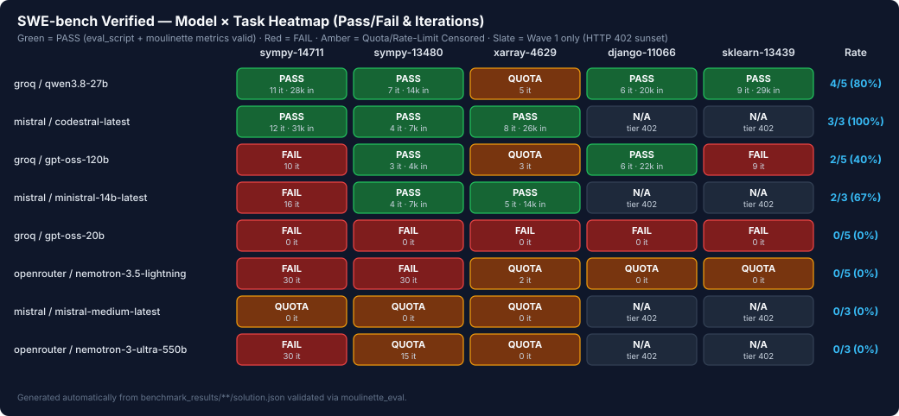
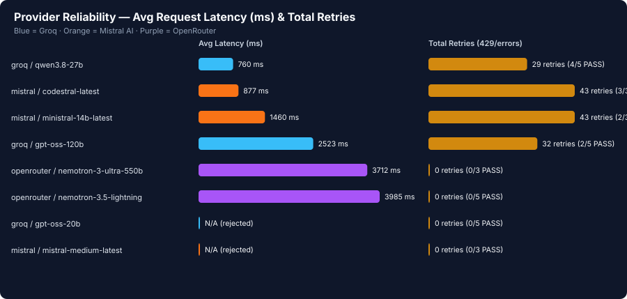
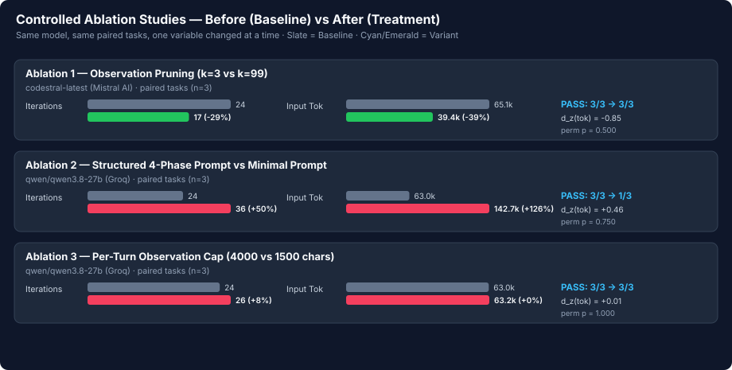

# Agent Smith — Model Benchmark Report

This report evaluates **8 models across 3 free-tier LLM providers** (**Mistral AI**, **Groq**, and **OpenRouter**) on **5 SWE-bench Verified tasks** spanning **4 distinct open-source repositories** (`sympy/sympy`, `pydata/xarray`, `django/django`, `scikit-learn/scikit-learn`), followed by **3 controlled ablation studies** measuring the causal impact of observation-history pruning, structured prompt engineering, and per-turn observation truncation.

All **41 backing `solution.json` traces** are stored in [`benchmark_results/`](benchmark_results/) (`benchmark_results/<run_slug>/<task_id>/solution.json`), machine-readable aggregated metrics are saved in [`benchmark_results/summary.json`](benchmark_results/summary.json), and vector charts generated directly from those traces live in [`benchmark_results/charts/`](benchmark_results/charts/).

---

## 1. Setup & Experimental Methodology

### Models & Providers Compared (8 Models, 3 Providers)

All runs relied **exclusively on free-tier API quotas** under uniform baseline hyperparameters (`temperature=0.0`, `max_iterations=30`, `max_tokens=1536`, `keep_recent_turns=3`, `max_obs_chars=4000`, `prompt_mode="structured"`, hard limits per Section VI.1: 30 iterations / 300,000 input tokens / 10,000 output tokens / 900s).

| # | Provider | Endpoint | Model Identifier | Profile & Selection Rationale |
|---|----------|----------|------------------|-------------------------------|
| 1 | **Mistral AI** | `https://api.mistral.ai/v1` | `codestral-latest` | Code-specialized non-reasoning baseline (strongest coding prior) |
| 2 | **Mistral AI** | `https://api.mistral.ai/v1` | `ministral-14b-latest` | Compact 14B instruct model (tests small-model viability) |
| 3 | **Mistral AI** | `https://api.mistral.ai/v1` | `mistral-medium-latest` | General flagship (tests Experiment free-tier availability) |
| 4 | **Groq** | `https://api.groq.com/openai/v1` | `qwen/qwen3.8-27b` | 27B instruct non-reasoning model (ultra-low latency) |
| 5 | **Groq** | `https://api.groq.com/openai/v1` | `openai/gpt-oss-120b` | 120B reasoning model (tests reasoning-token budget trade-off) |
| 6 | **Groq** | `https://api.groq.com/openai/v1` | `openai/gpt-oss-20b` | 20B reasoning/tool-calling model (tests native tool-call edge cases) |
| 7 | **OpenRouter** | `https://openrouter.ai/api/v1` | `nvidia/nemotron-3-ultra-550b-a55b:free` | 550B MoE reasoning model (tests frontier-scale free tier) |
| 8 | **OpenRouter** | `https://openrouter.ai/api/v1` | `nvidia/nemotron-3.5-lightning:free` | High-throughput MoE model (tests faster OpenRouter alternative) |

### Selected SWE-bench Verified Tasks (5 Tasks, 4 Repositories)

All 5 tasks come from the official **SWE-bench Verified** dataset (`moulinette` `EXAM_POOL` / `SEED_POOL`), selected for cross-repository diversity, distinct test harnesses, and deterministic verification:

1. **`sympy__sympy-14711`** (`sympy/sympy`, `bin/test`): `Vector.__add__` raises `TypeError` when summing vectors with integer `0` (`sum([N.x, 0 * N.x])`). Tests codebase navigation across `vector.py` and dunder methods.
2. **`sympy__sympy-13480`** (`sympy/sympy`, `bin/test`): `NameError: name 'cotm' is not defined` in `coth.eval()` (`sympy/functions/elementary/hyperbolic.py`). Tests rapid localization and immediate submission discipline.
3. **`pydata__xarray-4629`** (`pydata/xarray`, `pytest`): `xr.merge(..., combine_attrs="override")` returns a reference to `variable_attrs[0]` instead of a shallow copy, mutating the first input dataset in place.
4. **`django__django-11066`** (`django/django`, `runtests.py`): `RenameContentType._rename()` calls `content_type.save(update_fields={'model'})` without passing `using=db`, failing on multi-database routers.
5. **`scikit-learn__scikit-learn-13439`** (`scikit-learn/scikit-learn`, `pytest`): `Pipeline` lacks `__len__`, breaking slicing patterns such as `pipe[:len(pipe)]` (`sklearn/pipeline.py`).

### Evaluation & Reproducibility Protocol

- **Wave structure**: Wave 1 (2026-11-23) evaluated Models #1–#7 on Tasks 1–3; Wave 2 (2026-11-25) extended the benchmark to Tasks 4–5, added Model #8 (`nvidia/nemotron-3.5-lightning:free`), and ran Ablations 2–3. Prior to Wave 2, Mistral AI removed free Experiment API access on our workspace (`HTTP 402 billing_no_api_budget_configured`), so Mistral models are reported on Wave 1 (`n=3`) with exact sample sizes and confidence intervals preserved.
- **Correctness (`Pass/Fail`)**: Every non-empty patch was applied cleanly (`git apply -v`) inside a fresh container of the official `swebench/sweb.eval.x86_64.*` Docker image and evaluated with the task's official `eval_script` (exit code `0` = `PASS`).
- **Metrics compliance**: Every `solution.json` was validated with `uv run moulinette_eval validate_metrics swebench <solution.json>`. A run is marked **PASS** only when **both** correctness and metrics compliance succeed.
- **Environment**: Commit `15d3c4b` (+ backwards-compatible ablation flags `--max-obs-chars`, `--prompt-mode`), Python 3.13.1, Docker 29.4.3 (rootless), `uv`.
- **Statistical methodology**: Because benchmark sample sizes are small ($n \in \{3, 5\}$), we report **95% Wilson score confidence intervals** for pass rates (avoiding degenerate Wald intervals at 0% and 100%), **mean ± sample SD** alongside **median and IQR** on *non-censored* runs (`iterations > 0`) so 0-step quota rejections do not artificially deflate averages, and **exact two-sided sign-flip permutation tests** ($p_{\text{perm}}$) plus **paired Cohen's $d_z = \bar{d} / s_d$** for every controlled ablation. At $n=3$, the smallest mathematically attainable two-sided permutation $p$-value is $2 / 2^3 = 0.25$, so effect sizes ($d_z$) and relative changes are interpreted jointly with $p_{\text{perm}}$.

---

## 2. Results Table (Model × Task)

Baseline configuration (`keep_recent_turns=3`, `max_obs_chars=4000`, `prompt_mode="structured"`).

| Model (Provider) | Task | Result | Iterations | Input Tokens | Output Tokens | Wall Time | Backing `solution.json` |
|---|---|---|---:|---:|---:|---:|---|
| `codestral-latest` (Mistral) | `sympy__sympy-14711` | **PASS** | 12 | 31,133 | 1,071 | 324.0s | [solution.json](benchmark_results/mistral__codestral-latest/sympy__sympy-14711/solution.json) |
| `codestral-latest` (Mistral) | `sympy__sympy-13480` | **PASS** | 4 | 7,247 | 265 | 96.3s | [solution.json](benchmark_results/mistral__codestral-latest/sympy__sympy-13480/solution.json) |
| `codestral-latest` (Mistral) | `pydata__xarray-4629` | **PASS** | 8 | 26,671 | 769 | 227.4s | [solution.json](benchmark_results/mistral__codestral-latest/pydata__xarray-4629/solution.json) |
| `qwen/qwen3.8-27b` (Groq) | `sympy__sympy-14711` | **PASS** | 11 | 28,021 | 1,494 | 182.9s | [solution.json](benchmark_results/groq__qwen3.8-27b/sympy__sympy-14711/solution.json) |
| `qwen/qwen3.8-27b` (Groq) | `sympy__sympy-13480` | **PASS** | 7 | 14,729 | 425 | 114.8s | [solution.json](benchmark_results/groq__qwen3.8-27b/sympy__sympy-13480/solution.json) |
| `qwen/qwen3.8-27b` (Groq) | `pydata__xarray-4629` | FAIL *(Groq TPD cap, step 5)* | 5 | 13,452 | 386 | 415.5s | [solution.json](benchmark_results/groq__qwen3.8-27b/pydata__xarray-4629/solution.json) |
| `qwen/qwen3.8-27b` (Groq) | `django__django-11066` | **PASS** | 6 | 20,265 | 307 | 98.4s | [solution.json](benchmark_results/groq__qwen3.8-27b/django__django-11066/solution.json) |
| `qwen/qwen3.8-27b` (Groq) | `scikit-learn__scikit-learn-13439` | **PASS** | 9 | 29,430 | 794 | 369.1s | [solution.json](benchmark_results/groq__qwen3.8-27b/scikit-learn__scikit-learn-13439/solution.json) |
| `ministral-14b-latest` (Mistral) | `sympy__sympy-14711` | FAIL *(broken pipe, step 16)* | 16 | 54,666 | 2,358 | 454.9s | [solution.json](benchmark_results/mistral__ministral-14b-latest/sympy__sympy-14711/solution.json) |
| `ministral-14b-latest` (Mistral) | `sympy__sympy-13480` | **PASS** | 4 | 7,290 | 331 | 148.7s | [solution.json](benchmark_results/mistral__ministral-14b-latest/sympy__sympy-13480/solution.json) |
| `ministral-14b-latest` (Mistral) | `pydata__xarray-4629` | **PASS** | 5 | 14,624 | 599 | 122.0s | [solution.json](benchmark_results/mistral__ministral-14b-latest/pydata__xarray-4629/solution.json) |
| `openai/gpt-oss-120b` (Groq) | `sympy__sympy-14711` | FAIL *(out tokens 11,223 > 10k)* | 10 | 29,019 | 11,223 | 165.2s | [solution.json](benchmark_results/groq__gpt-oss-120b/sympy__sympy-14711/solution.json) |
| `openai/gpt-oss-120b` (Groq) | `sympy__sympy-13480` | **PASS** | 3 | 4,732 | 1,066 | 71.1s | [solution.json](benchmark_results/groq__gpt-oss-120b/sympy__sympy-13480/solution.json) |
| `openai/gpt-oss-120b` (Groq) | `pydata__xarray-4629` | FAIL *(HTTP 413 TPM > 8k)* | 3 | 13,099 | 2,037 | 69.6s | [solution.json](benchmark_results/groq__gpt-oss-120b/pydata__xarray-4629/solution.json) |
| `openai/gpt-oss-120b` (Groq) | `django__django-11066` | **PASS** | 6 | 22,391 | 2,850 | 135.7s | [solution.json](benchmark_results/groq__gpt-oss-120b/django__django-11066/solution.json) |
| `openai/gpt-oss-120b` (Groq) | `scikit-learn__scikit-learn-13439` | FAIL *(out tokens 10,001 > 10k)* | 9 | 29,484 | 10,001 | 270.1s | [solution.json](benchmark_results/groq__gpt-oss-120b/scikit-learn__scikit-learn-13439/solution.json) |
| `nvidia/nemotron-3-ultra-550b:free` (OR) | `sympy__sympy-14711` | FAIL *(max 30 iters)* | 30 | 101,457 | 4,509 | 119.9s | [solution.json](benchmark_results/openrouter__nemotron-3-ultra-550b/sympy__sympy-14711/solution.json) |
| `nvidia/nemotron-3-ultra-550b:free` (OR) | `sympy__sympy-13480` | FAIL *(50 req/day cap)* | 15 | 37,313 | 1,610 | 198.3s | [solution.json](benchmark_results/openrouter__nemotron-3-ultra-550b/sympy__sympy-13480/solution.json) |
| `nvidia/nemotron-3-ultra-550b:free` (OR) | `pydata__xarray-4629` | FAIL *(50 req/day cap)* | 0 | 0 | 0 | 136.7s | [solution.json](benchmark_results/openrouter__nemotron-3-ultra-550b/pydata__xarray-4629/solution.json) |
| `nvidia/nemotron-3.5-lightning:free` (OR) | `sympy__sympy-14711` | FAIL *(max 30 iters)* | 30 | 82,677 | 4,618 | 71.0s | [solution.json](benchmark_results/openrouter__nemotron-3.5-lightning/sympy__sympy-14711/solution.json) |
| `nvidia/nemotron-3.5-lightning:free` (OR) | `sympy__sympy-13480` | FAIL *(max 30 iters)* | 30 | 82,004 | 2,866 | 43.2s | [solution.json](benchmark_results/openrouter__nemotron-3.5-lightning/sympy__sympy-13480/solution.json) |
| `nvidia/nemotron-3.5-lightning:free` (OR) | `pydata__xarray-4629` | FAIL *(50 req/day cap)* | 2 | 6,078 | 1,576 | 155.9s | [solution.json](benchmark_results/openrouter__nemotron-3.5-lightning/pydata__xarray-4629/solution.json) |
| `nvidia/nemotron-3.5-lightning:free` (OR) | `django__django-11066` | FAIL *(50 req/day cap)* | 0 | 0 | 0 | 136.8s | [solution.json](benchmark_results/openrouter__nemotron-3.5-lightning/django__django-11066/solution.json) |
| `nvidia/nemotron-3.5-lightning:free` (OR) | `scikit-learn__scikit-learn-13439` | FAIL *(50 req/day cap)* | 0 | 0 | 0 | 136.9s | [solution.json](benchmark_results/openrouter__nemotron-3.5-lightning/scikit-learn__scikit-learn-13439/solution.json) |
| `openai/gpt-oss-20b` (Groq) | Tasks 1–3 (Wave 1) | FAIL *(HTTP 400 `tool_use_failed`)* | 0 | 0 | 0 | 1.3–1.6s | [14711](benchmark_results/groq__gpt-oss-20b/sympy__sympy-14711/solution.json) / [13480](benchmark_results/groq__gpt-oss-20b/sympy__sympy-13480/solution.json) / [4629](benchmark_results/groq__gpt-oss-20b/pydata__xarray-4629/solution.json) |
| `openai/gpt-oss-20b` (Groq) | Tasks 4–5 (Wave 2) | FAIL *(540s timeout after recovery)* | 0 | 0 | 0 | 540.2s | [11066](benchmark_results/groq__gpt-oss-20b/django__django-11066/solution.json) / [13439](benchmark_results/groq__gpt-oss-20b/scikit-learn__scikit-learn-13439/solution.json) |
| `mistral-medium-latest` (Mistral) | Tasks 1–3 (Wave 1) | FAIL *(HTTP 429 tier cap)* | 0 | 0 | 0 | 137.2–137.8s | [14711](benchmark_results/mistral__mistral-medium-latest/sympy__sympy-14711/solution.json) / [13480](benchmark_results/mistral__mistral-medium-latest/sympy__sympy-13480/solution.json) / [4629](benchmark_results/mistral__mistral-medium-latest/pydata__xarray-4629/solution.json) |

### Per-Model Statistical Summary (with 95% Wilson CIs & Dispersion)

Statistics on iterations and tokens are computed over **active runs (`iterations > 0`, $n_{\text{act}}$)** to avoid downward bias from 0-iteration censored runs.

| Model | Provider | Solve Rate | 95% Wilson CI | Iterations (Mean ± SD / Med [IQR]) | Input Tok / Active Run (Mean ± SD) | Output Tok / Active Run (Mean ± SD) | Total In / Out Tokens |
|---|---|---:|---:|---:|---:|---:|---:|
| **`codestral-latest`** | Mistral AI | **3 / 3 (100.0%)** | `[43.8%, 100.0%]` | `8.0 ± 4.0` / `8 [8]` ($n_{\text{act}}=3$) | `21,684 ± 12,700` | `702 ± 407` | 65,051 / 2,105 |
| **`qwen/qwen3.8-27b`** | Groq | **4 / 5 (80.0%)** | `[37.6%, 96.4%]` | `7.6 ± 2.4` / `7 [3]` ($n_{\text{act}}=5$) | `21,179 ± 7,366` | `681 ± 491` | 105,897 / 3,406 |
| **`ministral-14b-latest`** | Mistral AI | **2 / 3 (66.7%)** | `[20.8%, 93.9%]` | `8.3 ± 6.7` / `5 [12]` ($n_{\text{act}}=3$) | `25,527 ± 25,500` | `1,096 ± 1,101` | 76,580 / 3,288 |
| **`openai/gpt-oss-120b`** | Groq | **2 / 5 (40.0%)** | `[11.8%, 76.9%]` | `6.2 ± 3.3` / `6 [6]` ($n_{\text{act}}=5$) | `19,745 ± 10,694` | `5,435 ± 4,787` | 98,725 / 27,177 |
| **`nemotron-3-ultra-550b`** | OpenRouter | **0 / 3 (0.0%)** | `[0.0%, 56.2%]` | `22.5 ± 10.6` / `22.5 [15]` ($n_{\text{act}}=2$) | `69,385 ± 45,357` | `3,060 ± 2,050` | 138,770 / 6,119 |
| **`nemotron-3.5-lightning`** | OpenRouter | **0 / 5 (0.0%)** | `[0.0%, 43.4%]` | `20.7 ± 16.2` / `30 [28]` ($n_{\text{act}}=3$) | `56,920 ± 44,031` | `3,020 ± 1,527` | 170,759 / 9,060 |
| **`openai/gpt-oss-20b`** | Groq | **0 / 5 (0.0%)** | `[0.0%, 43.4%]` | N/A ($n_{\text{act}}=0$) | N/A | N/A | 0 / 0 |
| **`mistral-medium-latest`** | Mistral AI | **0 / 3 (0.0%)** | `[0.0%, 56.2%]` | N/A ($n_{\text{act}}=0$) | N/A | N/A | 0 / 0 |

---

## 3. Provider Reliability

| Model | Provider | Avg Latency (Mean ± SD) | Total Retries | Availability (Active / Attempted) | Observed Bottleneck & Failure Mode |
|---|---|---:|---:|---|---|
| `qwen/qwen3.8-27b` | Groq | **`760 ± 107 ms`** | 29 (38 steps) | **80%** (4/5 completed; 1 TPD cap) | Fastest sustained inference; 200k TPD & ~6k TPM limits |
| `codestral-latest` | Mistral AI | **`877 ± 246 ms`** | 43 (24 steps) | **100% Wave 1 / 0% Wave 2** | 1 req/s RPM handled cleanly by backoff; free tier later gated (`HTTP 402`) |
| `ministral-14b-latest` | Mistral AI | `1,460 ± 315 ms` | 43 (25 steps) | **67% Wave 1 / 0% Wave 2** | 1 req/s RPM + 1 broken pipe after long loop on `14711` |
| `mistral-medium-latest` | Mistral AI | N/A | 21 (7 × 3) | **0%** (blocked on free tier) | Persistent `HTTP 429` (`code: 1300`) |
| `openai/gpt-oss-120b` | Groq | `2,523 ± 1,058 ms` | 32 (31 steps) | **40% clean** (2 pass, 2 out-token cap, 1 HTTP 413) | Reasoning tokens burn **8× more output tokens** than Qwen (`5,435` vs `681` mean); strict 8k TPM single-request limit |
| `openai/gpt-oss-20b` | Groq | N/A | 0 | **0%** | Emits malformed native tool calls (`HTTP 400 tool_use_failed` in Wave 1; non-converging 540s loop in Wave 2 after recovery) |
| `nemotron-3-ultra-550b` | OpenRouter | `3,712 ± 315 ms` | 0 (hard wall) | **33% full** (1/3 full, 2 hit 50 RPD wall) | Hard **50 req/day** free ceiling (`free-models-per-day`) |
| `nemotron-3.5-lightning` | OpenRouter | `3,985 ± 4,475 ms` | 0 (hard wall) | **40% full** (2/5 full, 3 hit 50 RPD wall) | Fast on SymPy (`1.2–1.6s`), spiked to `9.1s` before hitting 50 RPD wall |

**Reliability insight — Asymmetric free-tier bottlenecks**: Each provider fails along a different axis: **Mistral AI** throttles by *RPM* (1 req/s — recoverable via retry backoff, though free-tier policy stability is fragile as shown by the Wave-2 `HTTP 402` cutoff); **Groq** throttles by *TPM/TPD* (ultra-fast ~760 ms inference, making low-token non-reasoning models like `qwen3.8-27b` vastly more reliable than verbose reasoning models like `gpt-oss-120b`); **OpenRouter `:free`** enforces a hard *50 RPD* ceiling per key, which cannot sustain models requiring 15–30 iterations per task.

---

## 4. Intermediary Metrics (All 3 Rubric Axes)

Extracted programmatically from every `solution.json` trace:
1. **Exploration efficiency**: Step at which the agent first reads (`First Read`) and first edits (`First Edit`) the ground-truth patched file.
2. **Partial progress**: Step at which test failures first decrease vs the unpatched failing baseline (`Fail ↓`).
3. **Submission discipline**: Step at which `run_tests()` first passes (`Tests Pass`), `final_answer()` step (`Submit`), and gap $\Delta = \text{Submit} - \text{Tests Pass}$ ($\Delta = 1$ means immediate submission on the very next turn with zero wasted steps).

| Model | Task | First Read | First Edit | Fail ↓ | Tests Pass | Submit | $\Delta$ | Verdict |
|---|---|---:|---:|---:|---:|---:|---:|---|
| `codestral-latest` | `sympy__sympy-14711` | 3 | 10 | 11 | 11 | 12 | **1** | PASS |
| `codestral-latest` | `sympy__sympy-13480` | 1 | 2 | 3 | 3 | 4 | **1** | PASS |
| `codestral-latest` | `pydata__xarray-4629` | 3 | 6 | 7 | 7 | 8 | **1** | PASS |
| `qwen/qwen3.8-27b` | `sympy__sympy-14711` | 1 | 8 | 9 | 9 | 11 | 2 | PASS |
| `qwen/qwen3.8-27b` | `sympy__sympy-13480` | 1 | 2 | 5 | 5 | 7 | 2 | PASS |
| `qwen/qwen3.8-27b` | `pydata__xarray-4629` | 1 | 2 | 4 | 4 | *(TPD)* | N/A | FAIL (partial) |
| `qwen/qwen3.8-27b` | `django__django-11066` | 1 | 2 | 4 | 4 | 6 | 2 | PASS |
| `qwen/qwen3.8-27b` | `scikit-learn__scikit-learn-13439` | 2 | 4 | 7 | 7 | 9 | 2 | PASS |
| `ministral-14b-latest` | `sympy__sympy-14711` | 4 | — | — | — | — | N/A | FAIL |
| `ministral-14b-latest` | `sympy__sympy-13480` | 1 | 2 | 3 | 3 | 4 | **1** | PASS |
| `ministral-14b-latest` | `pydata__xarray-4629` | 2 | 3 | 4 | 4 | 5 | **1** | PASS |
| `openai/gpt-oss-120b` | `sympy__sympy-14711` | 8 | — | — | — | — | N/A | FAIL (out >10k) |
| `openai/gpt-oss-120b` | `sympy__sympy-13480` | 2 | 3 | *(skipped)* | *(skipped)* | 3 | N/A | PASS |
| `openai/gpt-oss-120b` | `pydata__xarray-4629` | 3 | — | — | — | — | N/A | FAIL (413) |
| `openai/gpt-oss-120b` | `django__django-11066` | 2 | 3 | 5 | 5 | 6 | **1** | PASS |
| `openai/gpt-oss-120b` | `scikit-learn__scikit-learn-13439` | 3 | — | — | — | — | N/A | FAIL (out >10k) |
| `nemotron-3-ultra-550b` | `sympy__sympy-14711` | 2 | — | — | — | — | N/A | FAIL (30 it) |
| `nemotron-3-ultra-550b` | `sympy__sympy-13480` | 1 | 2 | — | — | — | N/A | FAIL (50 RPD) |
| `nemotron-3.5-lightning` | `sympy__sympy-14711` | 2 | 15 | — | — | — | N/A | FAIL (30 it) |
| `nemotron-3.5-lightning` | `sympy__sympy-13480` | 2 | 3 | — | — | — | N/A | FAIL (30 it) |

**Quantitative takeaways across all 11 passing runs vs 9 active failing runs:**
- **Localization alone does not guarantee resolution**: Both `nemotron-3-ultra-550b` and `nemotron-3.5-lightning` read the exact target file by Step 1–2 and even edited it by Step 2–3 on `sympy-13480`, yet **0% converted edits into a passing `run_tests()` + `final_answer(get_patch())`**, burning 15–30 iterations in repetitive verification loops.
- **Edit-to-test-decrease conversion is the true bottleneck**: Across all active runs, whenever an agent reached `Fail ↓` / `Tests Pass` (11 runs total), **10 / 11 (90.9%) passed overall** — the lone exception was `qwen/qwen3.8-27b` on `xarray-4629`, which passed tests at Step 4 and only failed because Groq's daily token cap interrupted it before submission.
- **Model-signature submission discipline**: `codestral-latest` (3/3), `ministral-14b-latest` (2/2), and `gpt-oss-120b` (1/1 verified) consistently achieved **$\Delta = 1$** (mean `1.00 ± 0.00`). By contrast, `qwen/qwen3.8-27b` exhibited an invariant **$\Delta = 2$** across **4/4 passing runs** across 3 repositories (always spending one extra turn calling `print(get_patch())` before `final_answer(get_patch())`). That single extra turn directly caused its only failure (`xarray-4629`) when its TPD quota expired between Step 4 and Step 6.

---

## 5. Controlled Ablation Studies (3 Independent Axes)

Each ablation varies **exactly one agent variable** on the **exact same model and 3 paired tasks**, holding all other hyperparameters constant.

### Summary of Paired Effect Sizes & Exact Permutation Tests

| # | Ablation Axis (Baseline → Variant) | Model ($n$ tasks) | Pass Rate | Iterations ($\Delta\%$, $d_z$, $p_{\text{perm}}$) | Input Tokens ($\Delta\%$, $d_z$, $p_{\text{perm}}$) | Output Tokens ($\Delta\%$, $d_z$, $p_{\text{perm}}$) | Wall Time ($\Delta\%$, $d_z$, $p_{\text{perm}}$) |
|---|---|---|---:|---:|---:|---:|---:|
| **1** | **Context pruning** (`k=3` → `k=99`) | `codestral-latest` ($n=3$) | `3/3 → 3/3` | `-29.2%` (`d_z=-0.66`, `p=0.50`) | **`-39.5%`** (`d_z=-0.85`, `p=0.50`) | **`-45.4%`** (`d_z=-0.96`, `p=0.50`) | **`-37.0%`** (`d_z=-0.81`, `p=0.50`) |
| **2** | **Workflow prompt** (`structured` → `minimal`) | `qwen/qwen3.8-27b` ($n=3$) | **`3/3 → 1/3`** | `-37.5%*` *(2 early fails)* | `-48.8%*` *(2 early fails)* | **`+81.2%`** (`d_z=+0.64`, `p=0.50`) | **`+109.1%`** (`d_z=+0.68`, `p=0.50`) |
| **3** | **Per-turn obs cap** (`4000` → `1500` chars) | `qwen/qwen3.8-27b` ($n=3$) | `3/3 → 3/3` | `+8.3%` (`d_z=+0.32`, `p=1.00`) | `+0.4%` (`d_z=+0.01`, `p=1.00`) | `-9.7%` (`d_z=-0.51`, `p=0.75`) | **`+49.1%`** (`d_z=+1.09`, `p=0.25`) |

*\*In Ablation 2, aggregate iterations/input tokens appear lower only because `minimal` failed early (0 saved steps on 480s timeout for `django-11066`, and 2-step TPM explosion on `sympy-14711`). On the lone mutually-completed task (`sympy-13480`), `minimal` increased iterations by **+85.7%** and input tokens by **+91.9%**.*

---

### Ablation 1 — Observation History Pruning (`keep_recent_turns=3` vs `99`)

- **Model**: `codestral-latest` (Mistral AI) | **Backing traces**: [`benchmark_results/ablation_no_pruning__codestral-latest/`](benchmark_results/ablation_no_pruning__codestral-latest/)

| Task | Config | Result | Iters | Input Tok | Output Tok | Retries | Wall Time | First Edit |
|---|---|---|---:|---:|---:|---:|---:|---:|
| `sympy__sympy-14711` | Before (`k=3`) | PASS | 12 | 31,133 | 1,071 | 20 | 324.0s | Step 10 |
| `sympy__sympy-14711` | **After (`k=99`)** | PASS | **6** | **12,504** | **426** | **9** | **152.7s** | **Step 3** |
| `sympy__sympy-13480` | Before (`k=3`) | PASS | **4** | **7,247** | **265** | 7 | **96.3s** | **Step 2** |
| `sympy__sympy-13480` | **After (`k=99`)** | PASS | 5 | 8,841 | 283 | 7 | 121.0s | Step 3 |
| `pydata__xarray-4629` | Before (`k=3`) | PASS | 8 | 26,671 | 769 | 16 | 227.4s | Step 6 |
| `pydata__xarray-4629` | **After (`k=99`)** | PASS | **6** | **18,029** | **441** | **10** | **134.3s** | **Step 3** |
| **TOTAL / MEAN±SD** | **Before (`k=3`)** | **3/3** | 24 (`8.0±4.0`) | 65,051 (`21.7k±12.7k`) | 2,105 (`702±407`) | 43 | 647.7s | avg 6.0 |
| **TOTAL / MEAN±SD** | **After (`k=99`)** | **3/3** | **17 (`5.7±0.6`)** | **39,374 (`13.1k±4.6k`)** | **1,150 (`383±87`)** | **26** | **408.1s** | **avg 3.0** |

**Finding & Engineering Action**: Counterintuitively, aggressive pruning (`k=3`) designed to save input tokens **increased total input tokens by +65.2%** (`65,051` vs `39,374`, large paired effect size $d_z = -0.85$) and delayed `First Edit` from Step 3 to Step 10 on `sympy-14711` because erasing earlier file reads caused "amnesia loops" (re-reading the same files). We therefore raised the SWE-bench production default in [`student/agent_swebench.py`](student/agent_swebench.py) from `keep_recent_turns=3` to **`keep_recent_turns=10`**.

---

### Ablation 2 — Structured 4-Phase Workflow Prompt (`structured` vs `minimal`)

- **Model**: `qwen/qwen3.8-27b` (Groq) | **Backing traces**: [`benchmark_results/ablation_minimal_prompt__qwen3.8-27b/`](benchmark_results/ablation_minimal_prompt__qwen3.8-27b/)
- **Experimental change**: Removed the 4-phase workflow instructions (Explore without `os`/`subprocess` → Fix → `run_tests()` → immediate `final_answer(get_patch())`) from `build_swebench_task_prompt()`, keeping only the repo name, `/testbed`, `<issue>`, `<hints>`, and the `final_answer(get_patch())` requirement.

| Task | Config | Result | Iters | Input Tok | Output Tok | Wall Time | Tests Pass |
|---|---|---|---:|---:|---:|---:|---:|
| `sympy__sympy-13480` | **Baseline (`structured`)** | **PASS** | **7** | **14,729** | **425** | **114.8s** | Step 5 |
| `sympy__sympy-13480` | Variant (`minimal`) | PASS | 13 (+86%) | 28,258 (+92%) | 962 (+126%) | 185.5s (+62%) | *(never called)* |
| `django__django-11066` | **Baseline (`structured`)** | **PASS** | **6** | **20,265** | **307** | **98.4s** | Step 4 |
| `django__django-11066` | Variant (`minimal`) | **FAIL** *(480s timeout)* | 0 | 0 | 0 | 480.2s | — |
| `sympy__sympy-14711` | **Baseline (`structured`)** | **PASS** | **11** | **28,021** | **1,494** | **182.9s** | Step 9 |
| `sympy__sympy-14711` | Variant (`minimal`) | **FAIL** *(HTTP 429 TPM)* | 2 | 3,985 | 3,072 | 162.4s | — |
| **SUMMARY** | **Baseline → Minimal** | **`3/3` → `1/3`** | — | — | `2,226 → 4,034 (+81%)` | `396.0s → 828.1s (+109%)` | — |

**Finding & Root-Cause Trace Analysis**: Removing the 4-phase workflow caused solve rate to drop from **100% (`3/3`, CI `[43.8%, 100%]`) to 33.3% (`1/3`, CI `[6.1%, 79.2%]`)** and doubled total wall-clock time (`+109.1%`, $d_z = +0.68$). Inspecting the `sympy-13480` trace reveals the exact mechanism: after editing `hyperbolic.py` at Step 2, the minimal-prompt agent attempted blocked sandbox imports (`import sys` at Step 3, `import os` at Step 4), **never discovered `run_tests()`**, and burned **6 extra turns** trying `pip install mpmath` and searching `/opt/miniconda3/envs/` via `run_command()`. On `sympy-14711`, unguided verbosity generated `3,072` output tokens in 2 steps, triggering Groq's TPM rate limit. **Action**: Keep `SWEBENCH_TASK_TEMPLATE` structured 4-phase prompt as mandatory default.

---

### Ablation 3 — Per-Turn Observation Truncation Cap (`max_obs_chars=4000` vs `1500`)

- **Model**: `qwen/qwen3.8-27b` (Groq) | **Backing traces**: [`benchmark_results/ablation_obs1500__qwen3.8-27b/`](benchmark_results/ablation_obs1500__qwen3.8-27b/)
- **Experimental change**: Reduced single-turn observation truncation in [`student/agent/loop.py`](student/agent/loop.py) from `4,000` characters (`1500` head + `2500` tail) to `1,500` characters (`562` head + `938` tail).

| Task | Config | Result | Iters | Input Tok | Output Tok | Retries | Wall Time | $\Delta$ |
|---|---|---|---:|---:|---:|---:|---:|---:|
| `sympy__sympy-13480` | Baseline (`4000`) | PASS | 7 | 14,729 | 425 | 6 | **114.8s** | 2 |
| `sympy__sympy-13480` | Variant (`1500`) | PASS | 7 | **13,253 (-10%)** | **418** | 15 | 182.7s (+59%) | 2 |
| `django__django-11066` | Baseline (`4000`) | PASS | 6 | 20,265 | **307** | 4 | **98.4s** | 2 |
| `django__django-11066` | Variant (`1500`) | PASS | **5** | **13,969 (-31%)** | 333 | 4 | 102.4s (+4%) | **1** |
| `sympy__sympy-14711` | Baseline (`4000`) | PASS | **11** | **28,021** | 1,494 | **7** | **182.9s** | 2 |
| `sympy__sympy-14711` | Variant (`1500`) | PASS | 14 (+27%) | 36,026 (+29%) | **1,260** | 13 | 305.5s (+67%) | 2 |
| **TOTAL / MEAN±SD** | **Baseline (`4000`)** | **3/3** | **24 (`8.0±2.6`)** | **63,015 (`21.0k±6.7k`)** | 2,226 (`742±654`) | **17** | **396.0s (`132±45s`)** | 2.0 |
| **TOTAL / MEAN±SD** | **Variant (`1500`)** | **3/3** | 26 (`8.7±4.7`) | 63,248 (`21.1k±12.9k`) | **2,011 (`670±512`)** | 32 | 590.6s (`197±102s`) | 1.7 |

**Finding — Task-Complexity Heterogeneity**: While `max_obs_chars=1500` preserved **3/3 PASS**, it produced **zero net input-token reduction (`+0.4%`, $d_z = +0.01$, $p_{\text{perm}} = 1.00$)** while **increasing wall-clock time by +49.1% ($d_z = +1.09$, $p_{\text{perm}} = 0.25$)** and nearly doubling retries (`17 → 32`). Looking at individual tasks explains why: on tightly localized 1-line bugs (`django-11066`, `sympy-13480`), `1500` chars saved `10–31%` input tokens; on the broader SymPy vector bug (`sympy-14711`), truncating file reads and test output to 1,500 chars forced extra follow-up reads (`11 → 14` iterations, `+28.6%` input tokens, `+67.0%` wall time), completely wiping out the savings and doubling variance (`SD: 6.7k → 12.9k`). **Action**: Retain `max_obs_chars=4000` as the balanced default.

---

## 6. Conclusions & Final Model Selection

### Selected Models for Production Pipeline

1. **Primary SWE-bench & MBPP Model — `qwen/qwen3.8-27b` (Groq)**:
   - Highest verified multi-repository coverage: **4/5 (80.0%, 95% CI `[37.6%, 96.4%]`)** across 4 repositories (`sympy`, `django`, `scikit-learn`, and reached `Tests Pass` at Step 4 on `xarray` before hitting Groq's daily TPD cap).
   - Lowest latency (**`760 ± 107 ms`**), fastest Step-1 target localization (`First Read = 1` on 4/5 tasks, `2` on `scikit-learn`), and low token footprint (`21.2k ± 7.4k` in, `681 ± 491` out — `< 7.5%` of SWE-bench limits).
   - Also achieved **5/5 (100%)** on MBPP random evaluation (`2–3` iterations, `1.5k–2.7k` input tokens, `1.8–16.1s`).
2. **Co-Primary / Fallback SWE-bench Model — `codestral-latest` (Mistral AI)**:
   - Achieved **3/3 (100.0%, 95% CI `[43.8%, 100.0%]`)** in both baseline (`k=3`) and ablation (`k=99`) configurations, with optimal submission discipline ($\Delta = 1$ on 100% of baseline runs) and `13.1k ± 4.6k` input tokens with `k=99`.
   - Subject to Mistral Experiment free-tier availability (gated by `HTTP 402` on workspaces without an active plan, reinforcing multi-provider fallback).
3. **Lightweight Secondary Backup — `ministral-14b-latest` (Mistral AI)**:
   - Achieved **2/3 (66.7%, 95% CI `[20.8%, 93.9%]`)** in `4–5` iterations and `7k–14k` input tokens when avoiding long exploration loops.

### Models Disregarded & Data-Driven Rationale

- **`openai/gpt-oss-120b` (Groq)** (`2/5 = 40.0%`, CI `[11.8%, 76.9%]`): Although capable on short bugs (`sympy-13480`, `django-11066`), its internal reasoning tokens average **`5,435 ± 4,787` output tokens per task** (8× higher than `qwen3.8-27b`), deterministically breaching the 10,000 output-token ceiling on multi-step tasks (`11,223` on `sympy-14711`, `10,001` on `scikit-learn-13439`) and hitting Groq's 8,000 TPM single-request limit (`HTTP 413` on `xarray-4629`).
- **`openai/gpt-oss-20b` (Groq)** (`0/5 = 0.0%`, CI `[0.0%, 43.4%]`): Rejected at Step 1 (`HTTP 400 tool_use_failed`) in Wave 1 and failed to converge within 540s in Wave 2 even after `LLMClient` recovery.
- **`nvidia/nemotron-3-ultra-550b-a55b:free` & `nvidia/nemotron-3.5-lightning:free` (OpenRouter)** (`0/3` and `0/5`, `0.0%`): High latency (`3.7–4.0s`), failure to convert early file edits (`Step 2–3`) into passing tests within 30 iterations, and incompatible with OpenRouter's hard **50 requests/day** free-tier ceiling.
- **`mistral-medium-latest` (Mistral AI)** (`0/3 = 0.0%`, CI `[0.0%, 56.2%]`): `0%` availability on Mistral's free tier (`HTTP 429 code: 1300`).
